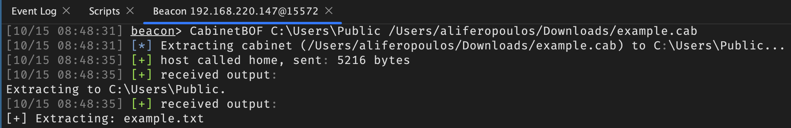

# CabinetBOF

A Beacon Object File that allows extraction of a cabinet (.CAB) file from memory to the file system. 

## Usage

`CabinetBOF <extraction_path> <local_cab_path>`

The cabinet file will be read from `<local_cab_path>` and extracted from memory to `<extraction_path>` on the target host.

## Building

CabinetBOF can be built using the provided scripts:

- Windows (MSVC / CL): Run `src/build.bat` from a Visual Studio Developer Command Prompt.
- Linux (MinGW): Run `src/build.sh` (requires x86_64-w64-mingw32-gcc and i686-w64-mingw32-gcc).

Both build methods produce CabinetBOF.x64.o and CabinetBOF.x86.o.

## Caveats

- Spanning cabinets are not supported.
- Partial files are not supported.